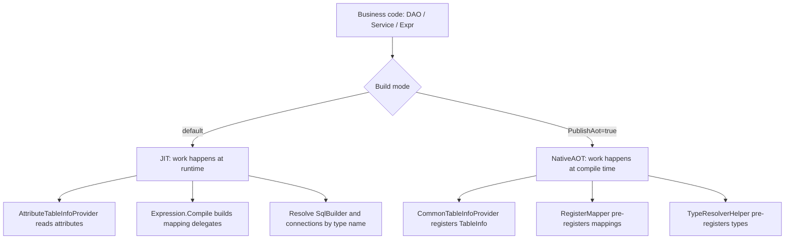

# NativeAOT Support

Both `LiteOrm` and `LiteOrm.Common` can be published under NativeAOT. With `PublishAot` enabled, the `LiteOrm.Generators` source generator takes over, at compile time, the work that would otherwise need runtime reflection and `Expression.Compile()`. The runtime no longer depends on dynamic code, and trimming warnings drop to zero. The `LiteOrm.AotDemo` project in this repo is a complete end-to-end verification example, covering full CRUD and `SearchAs` against SQLite, MySQL and Oracle.

> Note: `LiteOrm.DependencyInjection` is built on Autofac / Castle DynamicProxy and relies on runtime reflection and dynamic assembly generation, so it does **not support NativeAOT**. For AOT scenarios, register services with the base library's `AddLiteOrm()` (pure MS DI).

This article covers two things: where NativeAOT and JIT differ in usage, and what to watch out for when migrating.

## Differences from JIT

Business code reads the same in both modes. Every difference lives inside the framework. Same job, two approaches:

| Dimension | JIT (regular publish) | NativeAOT |
|------|--------------|-----------|
| Table metadata | `AttributeTableInfoProvider` reads attributes at runtime and builds the column model by reflection | `TableInfo` is generated at compile time and registered into `CommonTableInfoProvider` |
| DataReader mapping | mapping delegates compiled at runtime via `Expression.Compile()` | static delegates generated at compile time, pre-registered through `RegisterMapper<T>` |
| Property access | accessors compiled from expression trees | accessor delegates generated at compile time |
| `SqlBuilder` / `DbConnection` derived types | resolved by type name at runtime | derived types enumerated at compile time and pre-registered into `TypeResolverHelper` |
| `[AutoRegister]` services | registered by scanning assemblies at runtime | MS DI registration code generated at compile time, hooked up by a module initializer |
| DI wiring | `AddLiteOrm()` or `RegisterLiteOrm()` | `AddLiteOrm()` only, and no AOP |
| Remote calls | `LiteOrm.Remote` works | `LiteOrm.Remote` / `LiteOrm.Remote.Server` unavailable |
| First query | compiles the mapping delegate on the spot | uses the delegate that was already generated |



Four points deserve their own paragraph:

- **The metadata provider changes, and it carries less.** Under JIT, `AttributeTableInfoProvider` turns `[TableJoin]` / `[ForeignType]` / `[ForeignColumn]` into `TableView.JoinedTables`, and collects `[Column(Constant = ...)]` into `TableDefinition.ConstFilter`. Under AOT, `TableInfo` carries columns only; neither of those two is generated and both have to be filled in during startup. See the notes below.
- **There are three read-mapping paths, and speed depends on whether code was generated.** Entities marked with `[Table]` get a static delegate from the source generator in an AOT build. Entities without `[Table]`, projection types and anonymous types have no generated code and fall back to the `AotMapper` reflection path under AOT. Under JIT, every type goes through expression-tree compilation. Boxing only happens where it is actually needed: a column that hits a column-level converter goes through `GetValue()` plus a non-generic delegate, so that column boxes; a column without a converter reads through a hard-coded typed method in the generated code and does not box; the reflection path uses `GetValue()` plus `SetValue` uniformly and boxes every column.
- **AOP is gone.** `[Transaction]` / `[ServicePermission]` / `[ServiceLog]` rely on Castle dynamic proxies and are unavailable under NativeAOT. Transactions can move to the manual `DAOContext` transaction API, permission filtering to a runtime `Expr`, and logging to service events.

## Project Switches

```xml
<PropertyGroup>
  <IsAotCompatible>true</IsAotCompatible>
  <PublishAot>true</PublishAot>
  <InvariantGlobalization>true</InvariantGlobalization>
  <TrimMode>full</TrimMode>
  <EmitCompilerGeneratedFiles>true</EmitCompilerGeneratedFiles>
</PropertyGroup>
```

- The source generator only looks at build properties: `IsAotCompatible`, `PublishAot`, `PublishTrimmed` or `IsTrimmable` set to `true` each trigger generation on their own; you do not have to wait for `dotnet publish`. Non-AOT builds generate nothing and fall back to the runtime reflection path.
- The generator ships inside `LiteOrm.Common` (`analyzers/dotnet/cs`), so a NuGet reference to `LiteOrm` or `LiteOrm.Common` brings it in automatically. No hand-written `ProjectReference` is needed. The explicit reference in `LiteOrm.AotDemo` exists so the generator project can be compiled straight from the source tree.
- `EmitCompilerGeneratedFiles` is a debugging aid that writes generated code to disk for inspection; drop it for release builds.

## What the Source Generator Provides at Compile Time

1. **Table metadata**: generates `TableInfo` for each `[Table]` entity and registers it into `CommonTableInfoProvider`. Multiple assemblies share one global singleton, so they never overwrite each other.
2. **DataReader mapping delegates**: generates `RegisterMapper<T>` mappings. Each mapping initializes all of an entity's column converters in one shot (a static method plus an initialization flag, triggered lazily), then reuses the cached converters row by row; columns without a converter read through a typed method directly, avoiding runtime `Expression.Compile()` and repeated lookups.
3. **Property accessors and type registration**: `ObjectBase` property access, `SqlBuilder`-derived and `DbConnection`-derived types are all pre-registered into `TypeResolverHelper`, so the runtime can resolve them by name.
4. **DI registration**: services annotated with `[AutoRegister]` get MS DI registration code generated at compile time.

Among these, `CommonTableInfoProvider` lazily resolves and backfills column-level converters (`SqlTable.EnsureConverters`, initialized only once).

The generated content can be controlled in fine grain with the assembly-level `LiteOrmCodeGen`:

```csharp
[assembly: LiteOrm.Common.LiteOrmCodeGen(
    LiteOrm.Common.LiteOrmCodeGenKind.TableInfo |
    LiteOrm.Common.LiteOrmCodeGenKind.DataReaderMappers)]
```

`Kinds` accepts `TableInfo` / `DataReaderMappers` / `PropertyAccessors` / `AotTypeRegistration` / `AutoRegister`. Once declared, the attribute is the only source of truth and build properties are ignored; when absent, generators fall back to AOT auto-detection and generate everything. Declaring it in an ordinary build is a convenient way to verify AOT compatibility early.

## Notes and Caveats

Go through this list item by item before migrating to NativeAOT.

1. **Association metadata is not generated.** `[TableJoin]` / `[ForeignType]` / `[ForeignColumn]` do not reach `TableInfo` under AOT, so `TableView.JoinedTables` is always empty. Cross-table navigation, `ForeignColumn` projection and the implicit joins of `Expr` are all unavailable; write an explicit `Join` in the query when a relationship is needed.
2. **Constant slices declared in attributes do not produce `ConstFilter`.** Fixed conditions written into attributes, such as `[Column(Constant = ...)]`, are never collected into `TableDefinition.ConstFilter` under AOT. Multi-tenant row filtering and soft-delete slices must assign `TableDefinition.ConstFilter` during startup instead, carrying the value in a `GenericSqlExpr`. See example 3 in [Tenant Isolation](../typical-applications/tenant-isolation.en.md).
3. **Complex types require an explicit `[Column]`**: properties of complex types — arrays/collections and custom classes (`Object`) — are not auto-recognized as table columns without `[Column]`; mark them explicitly (specifying `DbType = Array` as needed) to persist them. `Json`/`Jsonb` mapped types are now auto-generated as columns.
4. **Column auto-mapping can be turned off**: with `[Table(AutoGenerateColumns = false)]`, the source generator collects only properties explicitly marked with `[Column]`; unmarked properties stay out of the table definition, matching the runtime `AttributeTableInfoProvider`.
5. **Converters must be declared or pre-registered**: complex/custom conversions must be declared via `Column.ConverterType`, `ForeignColumn.ConverterType`, or pre-registered via `SqlBuilder.RegisterDbValueConverter`. A global registration alone is not enough — the source generator has to see the attribute before it emits read code for that column. A converter must have a public parameterless constructor because the generator emits `new` directly; components that need configuration or secrets should use static initialization or environment variables instead.
6. **An entity caches exactly one read delegate**, decided by the data source dialect it binds to first. When the same entity is switched between data sources dynamically, either keep the column `DbValueType` identical across databases, or use a dedicated entity per data source, or fix the read rules with `DataReaderConverter.RegisterMapper<T>` during startup.
7. **Keep performance expectations level.** The source-generator path removes reflection and runtime compilation and beats pure reflection, but the reflection fallback and anonymous-type projections still box and reflect, so the whole picture trails JIT's typed reads. The gap shows up in row-by-row queries; writes and batch operations barely notice it.
8. **Prefer known strong types for projections.** Anonymous types take the `AotMapper` reflection path under AOT: workable, but slower, and it requires the target type's constructors and properties to survive trimming.

## Full CRUD and SearchAs Example

`LiteOrm.AotDemo` demonstrates full CRUD (including batch insert/update, `UpdateOrInsert`, `UpdateAll`, and the various deletes) plus `SearchAs`/`SearchOneAs` calls (sync and async):

```csharp
// Entity (AotUser) and view (AotUserView, both have generated DataReader mappers)
[Table("AotUsers")]
public class AotUser : ObjectBase
{
    [Column("Id", IsPrimaryKey = true, IsIdentity = true)]
    public int Id { get; set; }
    [Column("UserName")]
    public string? UserName { get; set; }
    [Column("Age")]
    public int Age { get; set; }
    [Column("Role")]
    public UserRole? Role { get; set; }
    [Column("CreateTime")]
    public DateTime CreateTime { get; set; }
    [Column("Guid")]
    public Guid Guid { get; set; }
    [Column("Info")]
    public JsonNode? Info { get; set; }
    [Column("Duration")]
    public TimeSpan Duration { get; set; }
}
public class AotUserView : AotUser { }

// Service
public interface IAotUserService : IEntityService<AotUser>, IEntityServiceAsync<AotUser>,
    IEntityViewService<AotUserView>, IEntityViewServiceAsync<AotUserView> { }

[AutoRegister]
public class AotUserService(IServiceProvider sp) : EntityService<AotUser, AotUserView>(sp), IAotUserService { }
```

```csharp
var userService = scope.ServiceProvider.GetRequiredService<IAotUserService>();

// ---- Insert ----
userService.Insert(new AotUser { UserName = "alice", Age = 30, CreateTime = DateTime.Now });
await userService.InsertAsync(new AotUser { UserName = "carol", Age = 28, CreateTime = DateTime.Now });
userService.BatchInsert(new[] { dave, eve });

// ---- Query / Count ----
var total = userService.Count(null);
var old = userService.Search(Expr.Prop("Age") > 20);
var alice = userService.SearchOne(Expr.Prop("UserName") == "alice");

// ---- SearchAs / SearchOneAs (Lambda projection to AotUserView) ----
var projected = userService.SearchAs(u => u.Where(x => x.Age > 20));
var one = userService.SearchOneAs(u => u.Where(x => x.UserName == "bob"));
var projectedAsync = await userService.SearchAsAsync(u => u.Where(x => x.Age > 20));
var oneAsync = await userService.SearchOneAsAsync(u => u.Where(x => x.UserName == "carol"));

// ---- Update ----
alice.Age = 31; userService.Update(alice);
userService.BatchUpdate(/* IEnumerable<AotUser> */);
userService.UpdateOrInsert(new AotUser { UserName = "frank", Age = 40, CreateTime = DateTime.Now });
int n = userService.UpdateAll(new UpdateExpr(new TableExpr(typeof(AotUser)),
    Expr.Prop("UserName") == "bob").Set(("Age", Expr.Const(26))));

// ---- Delete ----
userService.Delete(dave);          // by entity
userService.DeleteID(alice.Id);    // by primary key
var nd = await userService.DeleteAllAsync(Expr.Prop("UserName") == "frank");
```

See the full code in [AotDemo/Program.cs](../../LiteOrm.AotDemo/Program.cs). Example publish command:

```bash
dotnet publish LiteOrm.AotDemo/LiteOrm.AotDemo.csproj -c Release -r win-x64 --self-contained
```

## Related Links

- [Entity Mapping](../core-usage/entity-mapping.en.md)
- [View Models and Services](../core-usage/view-models-and-services.en.md)
- [Data Mapping and Value Conversion](./data-mapping.en.md)
- [Tenant Isolation](../typical-applications/tenant-isolation.en.md)
- [Performance Tuning](./performance.en.md)
