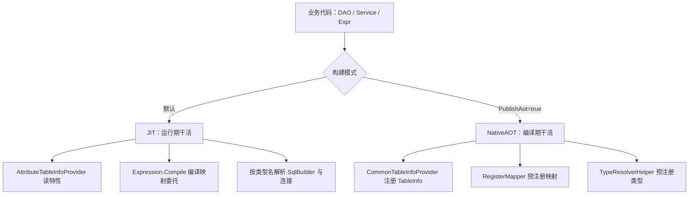

# NativeAOT 支持

`LiteOrm` 与 `LiteOrm.Common` 可以在 NativeAOT 下发布。开启 `PublishAot` 后，编译期由 `LiteOrm.Generators` 源生成器接替运行期反射与 `Expression.Compile()` 的工作，运行期不再依赖动态代码，裁剪告警也随之清零。仓库里的 `LiteOrm.AotDemo` 是端到端验证示例，跑通了 SQLite / MySQL / Oracle 三种数据源下的完整 CRUD 与 `SearchAs`。

> 注意：`LiteOrm.DependencyInjection` 基于 Autofac / Castle DynamicProxy，依赖运行时反射与动态程序集生成，**不支持 NativeAOT**。AOT 场景请使用基础库 `AddLiteOrm()` 进行纯 MS DI 注册。

本文讲两件事：NativeAOT 与 JIT 的用法差在哪里，以及迁过去之前要注意什么。

## 与 JIT 的差别

业务代码两种模式下一样写。差别全在框架内部。同一件事，两种做法：

| 维度 | JIT（普通发布） | NativeAOT |
|------|--------------|-----------|
| 表元信息 | `AttributeTableInfoProvider` 运行期读特性，反射建列模型 | 编译期生成 `TableInfo`，注册进 `CommonTableInfoProvider` |
| DataReader 映射 | 运行期 `Expression.Compile()` 编译委托 | 编译期生成静态委托，经 `RegisterMapper<T>` 预注册 |
| 属性访问 | 表达式树编译访问器 | 编译期生成访问器委托 |
| `SqlBuilder` / `DbConnection` 派生类型 | 运行期按类型名解析 | 编译期枚举派生类型，预注册到 `TypeResolverHelper` |
| `[AutoRegister]` 服务 | 运行时扫程序集注册 | 编译期生成 MS DI 注册代码，模块初始化器登记 |
| DI 线路 | `AddLiteOrm()` 或 `RegisterLiteOrm()` | 只能 `AddLiteOrm()`，且没有 AOP |
| 远程调用 | `LiteOrm.Remote` 可用 | `LiteOrm.Remote` / `LiteOrm.Remote.Server` 不可用 |
| 首次查询 | 现场编译映射委托 | 直接用生成好的委托 |



四条值得单独说：

- **元数据换了一个 Provider，装的内容也变少了。** JIT 下 `AttributeTableInfoProvider` 在首次访问某个实体时读它的特性，用反射建出列模型，再把 `[TableJoin]` / `[ForeignType]` / `[ForeignColumn]` 建成 `TableView.JoinedTables`，同时把所有列上的 `[Column(Constant = ...)]` 收成一个 `TableDefinition.ConstFilter`。AOT 下 `TableInfo` 只带列信息。这两样都要在启动期自己补，详见下面的注意事项。
- **读取映射有三条路径，快慢取决于有没有生成代码。** 标注 `[Table]` 的实体在 AOT 构建下由源生成器产出静态委托。投影类型和匿名类型没有生成代码，AOT 下退到 `AotMapper` 反射路径。JIT 下所有类型都走表达式树编译。
- **装箱只发生在确实需要它的地方。** 命中列级转换器的列走 `GetValue()` 加非泛型委托，这一列有装箱。没有转换器的列在生成代码里直接写死类型化读取，不装箱。反射路径统一 `GetValue()` 加 `SetValue`，每列都装箱。
- **AOP 没有了。** `[Transaction]` / `[ServicePermission]` / `[ServiceLog]` 靠 Castle 动态代理实现，NativeAOT 下不可用。事务可以改用手工事务 API。权限过滤改用运行时 `Expr`。日志改用服务事件。

## 工程开关

```xml
<PropertyGroup>
  <IsAotCompatible>true</IsAotCompatible>
  <PublishAot>true</PublishAot>
  <InvariantGlobalization>true</InvariantGlobalization>
  <TrimMode>full</TrimMode>
  <EmitCompilerGeneratedFiles>true</EmitCompilerGeneratedFiles>
</PropertyGroup>
```

- 源生成器只认构建属性：`IsAotCompatible`、`PublishAot`、`PublishTrimmed`、`IsTrimmable` 任意一个为 `true` 都会触发生成，不必等到 `dotnet publish`。非 AOT 构建不生成代码，走反射路径。
- 生成器由 `LiteOrm.Common` 打包（`analyzers/dotnet/cs`）。NuGet 方式引用 `LiteOrm` 或 `LiteOrm.Common` 即自动带入，不需要手写 `ProjectReference`。`LiteOrm.AotDemo` 里那条显式引用，是为了在源码树内直接编译生成器工程。
- `EmitCompilerGeneratedFiles` 只影响调试，用来把生成代码落到磁盘上核对，发布时可以去掉。

## 源生成器在编译期提供的能力

1. **表元信息**：为每个 `[Table]` 实体生成 `TableInfo` 并注册到 `CommonTableInfoProvider`。多个程序集共享同一个单例，不会互相覆盖。
2. **DataReader 映射委托**：为每个实体生成 `RegisterMapper<T>` 映射，映射里每个实体一次性初始化所有列转换器（静态方法加初始化标记位，惰性触发），随后逐行复用缓存的转换器，没有转换器的列直接走类型化读取，从而避免运行期 `Expression.Compile()` 与重复解析。
3. **属性访问器与类型注册**：`ObjectBase` 属性访问、`SqlBuilder` 派生与 `DbConnection` 派生类型均预注册到 `TypeResolverHelper`，运行期按名字就能拿到类型。
4. **DI 注册**：带 `[AutoRegister]` 的服务在编译期生成 MS DI 注册代码。

其中 `CommonTableInfoProvider` 对列级转换器（`DbValueConverter`）进行惰性解析并回填（`SqlTable.EnsureConverters`，仅初始化一次）。

生成内容可以用程序集级的 `LiteOrmCodeGen` 细粒度控制：

```csharp
[assembly: LiteOrm.Common.LiteOrmCodeGen(
    LiteOrm.Common.LiteOrmCodeGenKind.TableInfo |
    LiteOrm.Common.LiteOrmCodeGenKind.DataReaderMappers)]
```

`Kinds` 可取 `TableInfo` / `DataReaderMappers` / `PropertyAccessors` / `AotTypeRegistration` / `AutoRegister`。声明了它，就以定义为唯一依据，不再看构建属性。未声明时按 AOT 状态自动全量生成。在普通构建里显式声明，可以提前验证 AOT 兼容性。

## 注意事项

迁到 NativeAOT 之前，逐条对照下面几项。

1. **关联元数据不生成。** `[TableJoin]` / `[ForeignType]` / `[ForeignColumn]` 在 AOT 下不进 `TableInfo`，`TableView.JoinedTables` 恒为空。跨表导航、`ForeignColumn` 投影、`Expr` 的隐式关联都不可用。要关联就在查询里显式写 `Join`。
2. **特性里的固定切片不生成 `ConstFilter`。** `[Column(Constant = ...)]` 这类写在特性里的固定条件，AOT 下不会收进 `TableDefinition.ConstFilter`。多租户行过滤、软删除切片都要改。启动期给 `TableDefinition.ConstFilter` 赋值，值用 `GenericSqlExpr` 承载。写法见[多租户隔离](../typical-applications/tenant-isolation.md)的示例三。
3. **复杂类型需显式 `[Column]`。** 数组/集合、自定义类（`Object`）等复杂类型属性，未标注 `[Column]` 时不会被自动识别为表列；需显式 `[Column]`（并按需指定 `DbType = Array`）才会持久化。`Json`/`Jsonb` 映射类型已支持自动生成列。
4. **列自动映射可整体关闭。** `[Table(AutoGenerateColumns = false)]` 时源生成器只收集显式标注 `[Column]` 的属性，未标注的属性不进表定义，与运行时 `AttributeTableInfoProvider` 行为一致。
5. **转换器需显式声明或预注册。** 复杂或自定义转换须通过列级 `Column.ConverterType`、`ForeignColumn.ConverterType` 声明，或经 `SqlBuilder.RegisterDbValueConverter` 预注册，只靠全局注册不够，源生成器要看到特性才会为该列生成读取代码。转换器必须有公共无参构造函数，源生成器直接 `new`。要注入配置或密钥的组件改用静态初始化或环境变量。
6. **一个实体只缓存一份读取委托**，由首次绑定的数据源方言决定。由于这份委托是首次访问时按当时方言编译的，同一实体在多个数据源间动态切换时，要么保证各库该实体的列 `DbValueType` 一致，要么为不同数据源用专属实体，要么在启动期用 `DataReaderConverter.RegisterMapper<T>` 固定读取规则。
7. **性能预期放平。** 源生成器路径省掉了反射与运行期编译，比纯反射快，但反射兜底路径和匿名类型投影仍有装箱与反射调用，整体仍低于 JIT 的类型化读取。差距集中在逐行查询上，写入与批量操作几乎无感。
8. **投影类型尽量用已知强类型。** 匿名类型在 AOT 下走 `AotMapper` 反射路径，能用但更慢，且要求目标类型的构造函数与属性在裁剪后仍然保留。

## 完整 CRUD 与 SearchAs 示例

`LiteOrm.AotDemo` 演示了完整 CRUD（含批量插入/更新、`UpdateOrInsert`、`UpdateAll`、各种删除）与 `SearchAs`/`SearchOneAs`（同步 + 异步）的调用方式：

```csharp
// 实体（AotUser）与视图（AotUserView，含生成的 DataReader 映射）
[Table("AotUsers")]
public class AotUser : ObjectBase
{
    [Column("Id", IsPrimaryKey = true, IsIdentity = true)]
    public int Id { get; set; }
    [Column("UserName")]
    public string? UserName { get; set; }
    [Column("Age")]
    public int Age { get; set; }
    [Column("Role")]
    public UserRole? Role { get; set; }
    [Column("CreateTime")]
    public DateTime CreateTime { get; set; }
    [Column("Guid")]
    public Guid Guid { get; set; }
    [Column("Info")]
    public JsonNode? Info { get; set; }
    [Column("Duration")]
    public TimeSpan Duration { get; set; }
}
public class AotUserView : AotUser { }

// Service
public interface IAotUserService : IEntityService<AotUser>, IEntityServiceAsync<AotUser>,
    IEntityViewService<AotUserView>, IEntityViewServiceAsync<AotUserView> { }

[AutoRegister]
public class AotUserService(IServiceProvider sp) : EntityService<AotUser, AotUserView>(sp), IAotUserService { }
```

```csharp
var userService = scope.ServiceProvider.GetRequiredService<IAotUserService>();

// ---- 插入 ----
userService.Insert(new AotUser { UserName = "alice", Age = 30, CreateTime = DateTime.Now });
await userService.InsertAsync(new AotUser { UserName = "carol", Age = 28, CreateTime = DateTime.Now });
userService.BatchInsert(new[] { dave, eve });

// ---- 查询 / 计数 ----
var total = userService.Count(null);
var old = userService.Search(Expr.Prop("Age") > 20);
var alice = userService.SearchOne(Expr.Prop("UserName") == "alice");

// ---- SearchAs / SearchOneAs（Lambda 投影到 AotUserView）----
var projected = userService.SearchAs(u => u.Where(x => x.Age > 20));
var one = userService.SearchOneAs(u => u.Where(x => x.UserName == "bob"));
var projectedAsync = await userService.SearchAsAsync(u => u.Where(x => x.Age > 20));
var oneAsync = await userService.SearchOneAsAsync(u => u.Where(x => x.UserName == "carol"));

// ---- 更新 ----
alice.Age = 31; userService.Update(alice);
userService.BatchUpdate(/* IEnumerable<AotUser> */);
userService.UpdateOrInsert(new AotUser { UserName = "frank", Age = 40, CreateTime = DateTime.Now });
int n = userService.UpdateAll(new UpdateExpr(new TableExpr(typeof(AotUser)),
    Expr.Prop("UserName") == "bob").Set(("Age", Expr.Const(26))));

// ---- 删除 ----
userService.Delete(dave);          // 按实体
userService.DeleteID(alice.Id);    // 按主键
var nd = await userService.DeleteAllAsync(Expr.Prop("UserName") == "frank");
```

完整代码见 [AotDemo/Program.cs](../../LiteOrm.AotDemo/Program.cs)。完整发布命令示例：

```bash
dotnet publish LiteOrm.AotDemo/LiteOrm.AotDemo.csproj -c Release -r win-x64 --self-contained
```

## 相关链接

- [实体映射](../core-usage/entity-mapping.md)
- [视图模型与服务](../core-usage/view-models-and-services.md)
- [数据映射与值转换](./data-mapping.md)
- [多租户隔离](../typical-applications/tenant-isolation.md)
- [性能优化](./performance.md)
