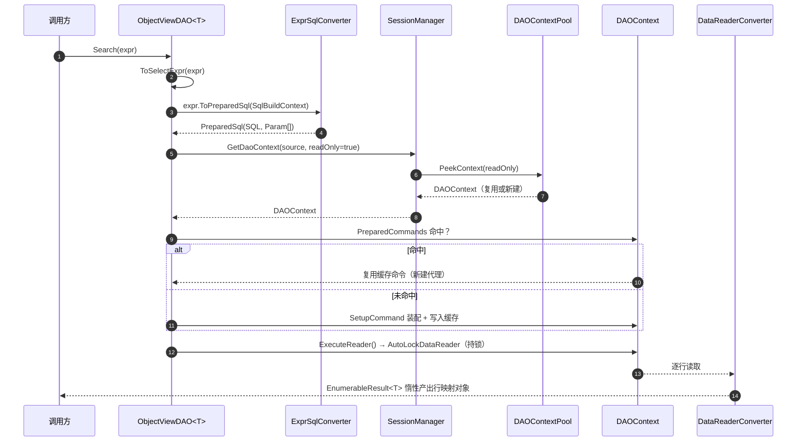

# 查询总览

LiteOrm 支持三种查询方式：**Lambda**、**`Expr`**、**`ExprString`**。它们最终都会生成参数化 SQL，但定位和适用场景不同。

读这篇只需要会写 C# 和一个简单的 `SELECT`。三种方式没有优劣，只有合不合适：条件写死在代码里用 Lambda，条件来自前端或配置文件用 `Expr`，想直接控制一段 SQL 用 `ExprString`。

本文是查询能力的总览与选型入口。三种方式的完整用法分别见：

- [Lambda 查询指南](./lambda-guide.md)
- [Expr 使用指南](./expr-guide.md)
- [ExprString 使用指南](./exprstring-guide.md)

## 1. 三种查询方式对比

| 方式 | 语法 | 更适合 | 类型安全 | 入口层 |
|------|------|--------|----------|--------|
| Lambda | `u => u.Age > 18` | 固定条件、业务语义清晰 | ✅ 强 | Service + DAO |
| `Expr` | `Expr.Prop("Age") > 18` | 动态拼装、查询构造器、多条件后台筛选 | ✅ 编译期 | Service + DAO |
| `ExprString` | `$"WHERE {expr}"` | DAO 中的条件片段或完整 SQL | ❌ 运行时 | 仅 DAO |

### 1.1 三者的关系

```
Lambda  ──(转换)──▶  Expr  ──(ToSql)──▶  参数化 SQL
                       ▲
                       │ (嵌入)
ExprString  ───────────┘ ──(ToSql)──▶  参数化 SQL
```

- **Lambda** 最终会先转换成 `Expr`，再统一生成 SQL，所以 Lambda 和 `Expr` 不是两套互相隔离的能力体系。
- **`ExprString`** 是独立的 SQL 拼装通道，但它的插值项可以嵌入 `Expr` 对象，复用 `Expr` 的参数化与引用符规则。

### 1.2 经验性选择

- **优先用 Lambda**：大部分业务查询最直观，强类型、可读性最好。
- **条件需要动态累加时用 `Expr`**：例如管理后台筛选、前端构造器、跨层传递过滤条件。
- **只在 DAO 需要手写 SQL 时用 `ExprString`**：它既能补 `Search` 的条件片段，也能传完整 SQL；Service 层不提供这个入口。

### 1.3 选型决策树

```
是否需要手写 SQL 片段或完整 SQL？
├─ 是 ─▶ 用 ExprString（仅 DAO 层）
└─ 否 ─▶ 条件是否需要动态累加 / 跨层传递？
        ├─ 是 ─▶ 用 Expr
        └─ 否 ─▶ 用 Lambda
```

## 2. Service 与 DAO 查询入口

LiteOrm 的查询入口分两层：**Service 层**面向业务，**DAO 层**面向更底层的能力。在入口之上，`QuerySource<T>` 负责组合查询链，`Join` / `JoinRelated` 负责多表连接。

### 2.1 Service

```csharp
using static LiteOrm.Common.Expr;

var users1 = await userService.SearchAsync(u => u.Age >= 18);
var users2 = await userService.SearchAsync(Prop("Age") >= 18);
var users3 = await userService.SearchAsAsync<UserSummary>(
    From<UserView>()
        .Where(Prop("Age") >= 18)
        .Select(
            Prop("Id"),
            Prop("UserName"),
            Expr.If(Prop("IsVip") == true, "VIP", "Normal").As("Level")
        )
);
```

- Service 查询入口以 Lambda / `Expr` 为主，同时支持基于 `SelectExpr` 的 `SearchAs(...)` / `SearchAsAsync(...)` 投影查询，以及接收 `IQueryable<T>` 的查询重载；适合业务语义清晰、需要事务/AOP/服务封装的场景。
- 需要跨层拼装查询时，可以用 `Expr.From<T>()` 起链（返回 `QuerySource<T>`），链尾调用 `GetQueryExpr()` 转成 `Expr`，或直接传给 `Search` / `SearchAs` 的 `IQueryable<T>` 重载。`Expr.Query` 与 IQueryable Lambda 写法同样保持可用。
- Service **不提供** `ExprString` 查询重载；如果需求已经变成"手写 SQL"，就应该切到 DAO。

### 2.2 DAO

```csharp
using static LiteOrm.Common.Expr;

var users1 = await userViewDAO.Search(u => u.Age >= 18).ToListAsync();
var users2 = await userViewDAO.Search(Prop("Age") >= 18).ToListAsync();
var users3 = await userViewDAO.Search($"WHERE {Prop("Age")} > {minAge}").ToListAsync();
```

- DAO 除了支持 Lambda / `Expr`，还支持 `ExprString`，因此更适合自定义 SQL 片段、完整 SQL、复杂投影查询和 DataTable 查询。
- 需要 `ExprString` 版 `SearchAs(...)`、`Query(...)`、`Execute(...)`、`GetValue(...)` 这类更底层能力时，也应该直接使用 DAO。

### 2.3 `QuerySource<T>`：可组合的查询源

`Expr.From<T>()` 返回 `QuerySource<T>`，它实现 `IQueryable<T>` / `IOrderedQueryable<T>`，因此 `Where` / `Select` / `OrderBy` 等 Linq 算子都能直接使用。它有两种用法：

- **在 Lambda 里当查询占位**：`Query<T, TResult>(q => q.Where(...))`，由解析器接管并生成 SQL。
- **在 Lambda 外拼查询**：链尾用 `GetQueryExpr()` 转成 `Expr`，或直接交给 Service / DAO 的 `IQueryable<T>` 重载执行。

```csharp
using static LiteOrm.Common.Expr;

// 1. 只拼表达式：不需要执行器
SqlSegment expr = From<User>()
    .Where(u => u.Age >= 18)
    .OrderBy(u => u.UserName)
    .Select(u => u.UserName)
    .GetQueryExpr();

// 2. 从容器取已绑定执行器的查询源，直接取数
var users = serviceProvider.GetRequiredService<QuerySource<User>>();
List<User> adults = await users.Where(u => u.Age >= 18).AsSource().ToListAsync();

// 3. 交给 DAO 执行任意 IQueryable 查询
var userDAO = serviceProvider.GetRequiredService<ObjectViewDAO<User>>();
var rows = await userDAO.SearchAs(
    users.Where(u => u.Age >= 18).Select(u => new { u.Id, u.UserName })).ToListAsync();
```

要点：

- `Where` / `Select` / `OrderBy` 的静态返回类型是 `IQueryable<T>` / `IOrderedQueryable<T>`；想继续调用 `QuerySource` 的异步实例方法（`ToListAsync`、`CountAsync`、`ToAsyncEnumerable` 等），用 `.AsSource()` 收窄。
- `Expr.From<T>()` 返回的实例不带执行器，只适合拼表达式，直接枚举会抛 `InvalidOperationException`。需要取数时从容器取 `QuerySource<T>`（已绑定执行器），或交给 DAO。
- `QuerySource<T>` 与 DAO 生命周期一致，不要缓存到单例或静态字段。

### 2.4 多表连接：`Join` / `JoinRelated`

`Join<T2>` 显式写连接条件，`JoinRelated<T2>` 按 `[ForeignType]` / `[TableJoin]` 元数据自动推断。两者都是 `QuerySource<T1>` 上的实例方法，左表已确定，所以只写右表类型：

```csharp
using static LiteOrm.Common.Expr;

// 显式条件
var joined = From<Order>()
    .Join<Customer>((o, c) => o.CustomerId == c.Id)
    .Where(x => x.Item2.Name == "VIP");

// 自动推断；可指定连接类型（默认 Left，可选 Inner / Right / Full）
var related = From<Order>().JoinRelated<Customer>(TableJoinType.Inner);

// 链式追加：每次只加一张右表，连接条件参数一表一个
var multi = From<Order>()
    .Join<Customer>((o, c) => o.CustomerId == c.Id)
    .Join<Region>((o, c, r) => c.RegionId == r.Id)
    .Where(x => x.Item3.Name == "North")
    .Select(x => new { x.Item1.Id, x.Item2.Name, x.Item3.Name });
```

- 返回 `QuerySource<T1, T2>`、`QuerySource<T1, T2, T3>` …，元素类型是**扁平元组** `(T1, T2)`、`(T1, T2, T3)`，用 `x.Item1` … `x.Item7` 访问，解析时会带上各自表的别名。
- 第二段及以后连接的 `on` 参数按「已连接的各表 + 新右表」顺序排列，直接按参数名引用，例如 `(o, c, r) => c.RegionId == r.Id`。
- `Join` 默认左连接；`JoinRelated` 使用元数据声明的连接类型，推断不到关联时抛 `InvalidOperationException`，提示改用带条件的 `Join`。在链式调用中，`JoinRelated` 按关联顺序从后向前匹配，优先用最近一次连接的表推断（例如 `JoinRelated<User>().JoinRelated<Dept>()` 走 `User → Dept`，回退到最后才用主表）。
- `Join` / `JoinRelated` 面向实体表，不要与视图混用。视图模型已通过 `[ForeignColumn]` 自动生成关联 JOIN，混用会重复连接并可能产生别名冲突；详见 [Lambda 查询指南 §5.4](./lambda-guide.md#54-连接查询-join-与-joinrelated)。
- 连接需在 `Where` / `Select` **之前**完成；如果已经 `Where`，可先用 `.AsSource()` 收窄再继续 `Join<TNext>`。
- 链式连接最多 7 张表。`Join` 之后接 `Select` 且写在 Lambda 里时，`Expr.Query<T, TResult>` 的 `TResult` 写 `IEnumerable<object>`。

完整规则、连接类型与别名细节见 [Lambda 查询指南 §5.4](./lambda-guide.md#54-连接查询-join-与-joinrelated)。

## 3. `Search` vs `SearchAs`

`Search` 和 `SearchAs` 都是查询入口，但职责不同：

| 维度 | `Search` / `SearchAsync` | `SearchAs<TResult>` / `SearchAsAsync<TResult>` |
|------|--------------------------|------------------------------------------------|
| 返回类型 | 实体类型 `T`（或视图 `TView`） | **任意** `TResult`：实体、匿名类型、标量、自定义投影类 |
| 查询构造 | `Expr` / Lambda / `IQueryable<T>` / `ExprString`（仅 DAO） | `SelectExpr`（Service+DAO）/ Lambda 投影 / `IQueryable<T>` / `ExprString`（仅 DAO） |
| 字段映射 | 按 `TableInfoProvider` 注册的 `SelectColumns` 位置映射 | 见下方注意事项 |
| 典型场景 | 「查这张表的数据」 | 「跨表投影、聚合、计算列、换类型」 |

### 3.1 基本用法对比

```csharp
using static LiteOrm.Common.Expr;

// Search：返回 User 实体列表
List<User> users = await viewService.SearchAsync(Prop("Age") >= 18);

// SearchAs：投影到匿名类型
var anonSummaries = await viewService.SearchAsAsync<dynamic>(
    From<UserView>()
        .Where(Prop("Age") >= 18)
        .Select(Prop("UserName"), Prop("Age"))
);

// SearchAs：投影到自定义类型
var summaries = await viewService.SearchAsAsync<UserSummary>(
    From<UserView>()
        .Where(Prop("Age") >= 18)
        .Select(
            Prop("Id"),
            Prop("UserName"),
            Expr.If(Prop("IsVip") == true, "VIP", "Normal").As("Level")
        )
);
```

### 3.2 `SearchAs` 使用的注意事项

`SearchAs<TResult>` 的结果映射由 `DataReaderConverter` 处理，按 `TResult` 是否注册到 `TableInfoProvider` 走不同路径，**初学者最容易在以下几处翻车**：

#### 3.2.1 `TResult` 的三种映射路径

| `TResult` 类型 | 映射方式 | 是否需要注册 |
|----------------|---------|-------------|
| **标量类型**（`int` / `string` / `DateTime` 等） | 直接读第 0 列 | 否 |
| **匿名类型**（`new { UserName = ..., Age = ... }`） | 按构造函数参数名匹配列名（不区分大小写） | 否 |
| **注册到 `TableInfoProvider` 的类型** | 按 `SelectColumns` 位置映射 | 是 |
| **未注册的普通类型** | 取**第一个公开构造函数**，按其参数名匹配列名（不区分大小写） | 否 |

> 关键差别：注册过的类型走「位置映射」，要求 `Select` 列顺序与 `TableInfoProvider` 注册顺序一致；未注册的普通类型 / 匿名类型走「列名匹配」，要求 `Select` 列的别名与构造函数参数名一致。

#### 3.2.2 列别名必须与目标成员名对应

对于「按名称匹配」的类型（匿名类型、未注册普通类），`Select` 列的别名（`.As("xxx")`）必须与目标类型的成员名（构造函数参数名）一致，否则字段会落到默认值：

```csharp
public class UserSummary
{
    public string UserName { get; set; }
    public string Level { get; set; }

    // 注意：DataReaderConverter 取 GetConstructors()[0]
    // 参数名必须与列别名一致
    public UserSummary(string userName, string level)
    {
        UserName = userName;
        Level = level;
    }
}

// ✅ 列别名 "Level" 与构造函数参数名 level 匹配
await viewService.SearchAsAsync<UserSummary>(
    From<UserView>().Select(
        Prop("UserName"),
        Expr.If(Prop("IsVip") == true, "VIP", "Normal").As("Level")
    )
);

// ❌ 没有用 .As("Level")，列名是 "Expr_If_..." 之类的自动名，Level 会变成 null
```

#### 3.2.3 标量结果用 `SearchAs<T>`，别用 `Search`

`COUNT` / `SUM` / `MAX` 等聚合查询只返回一个标量值，应该用 `SearchAs<int>` / `SearchAs<long>` 直接读第 0 列：

```csharp
// ✅ 标量投影
var count = await viewService.SearchAsAsync<int>(
    From<UserView>().Select(Expr.Func("COUNT", Prop("Id")))
);
```

#### 3.2.4 注册过的 `TResult` 走位置映射，列顺序要对

如果 `TResult` 是注册到 `TableInfoProvider` 的实体类型（比如直接用 `SearchAs<User>`），按 `SelectColumns` 位置映射，`Select` 列的**顺序**必须与注册的列顺序一致，列名不参与匹配。建议**优先用未注册的投影类型**（DTO / 匿名类型）来避免顺序耦合。

#### 3.2.5 `TResult` 必须可实例化

- 需要有公开构造函数
- 匿名类型天然满足（编译器生成）
- DTO / record 需要有公共构造函数
- 接口 / 抽象类 / 没有公开构造函数的类型会失败

#### 3.2.6 DAO 比 Service 多两个重载

| 重载 | Service | DAO |
|------|---------|-----|
| `SearchAs<TResult>(SelectExpr)` | ✅ 返回 `List<TResult>` | ✅ 返回 `EnumerableResult<TResult>` |
| `SearchAs<TResult>(Expression<Func<IQueryable<T>, IQueryable<TResult>>>)` | ✅ 返回 `List<TResult>`（Lambda 投影扩展） | ✅ Lambda 投影 |
| `SearchAs<TResult>(ref ExprString sqlBody)` | ❌ | ✅ 原生 SQL 投影 |

需要原生 SQL 投影（`ExprString`）时切到 DAO；Lambda 投影在 Service 已直接支持（见 [Lambda 查询指南](./lambda-guide.md#6-投影查询searchas-searchoneas)）。

## 4. 一次查询内部走了哪些路



1. 表达式转 SQL。 `Search(expr)` 先经 `ToSelectExpr` 补全 SELECT 列表，再 `ToPreparedSql` 产出 `PreparedSql`。
2. 取连接。 默认走只读池；会话在事务里，则强制回主库（`SessionManager.cs:533`）。
3. 命令缓存。 按 `(ObjectType, methodName)` 命中即复用；`Insert` 与 `BatchInsert` 恒走缓存，带固定切片条件的语句和含计算列 `Expr` 的 `GetObject` 每次新建。
4. 执行并持锁。 `ExecuteReader` 返回 `AutoLockDataReader`，锁一直拿到结果读完。
5. 惰性求值。 返回 `EnumerableResult<T>`，真正执行在 `ToList()` 或 `FirstOrDefault()`。省内存，也允许在求值前接着拼条件；代价是连接占用时间被拉长，记得及时释放结果对象。

## 5. 相关链接

- [增删改查](./crud-guide.md)
- [Lambda 查询指南](./lambda-guide.md)
- [Expr 使用指南](./expr-guide.md)
- [ExprString 使用指南](./exprstring-guide.md)
- [关联查询](./associations.md)
- [Lambda 与 Expr 组合使用](./lambda-expr-mixing.md)
- [CTE 指南](./cte-guide.md)
- [表达式扩展](../extensibility/expression-extension.md)
